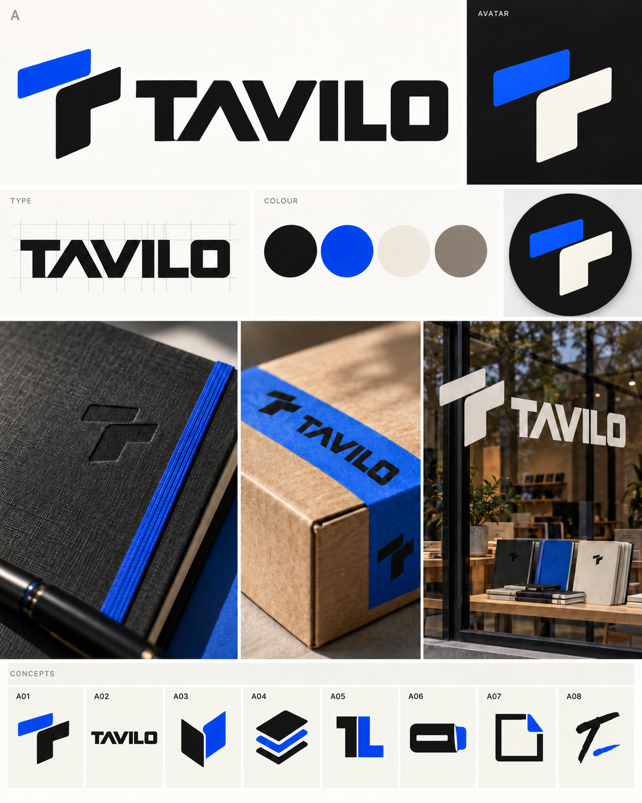
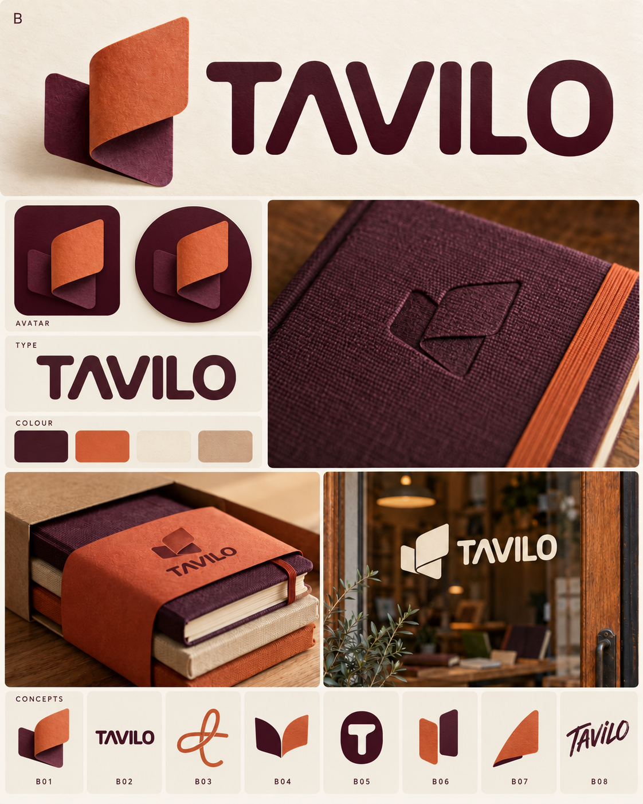
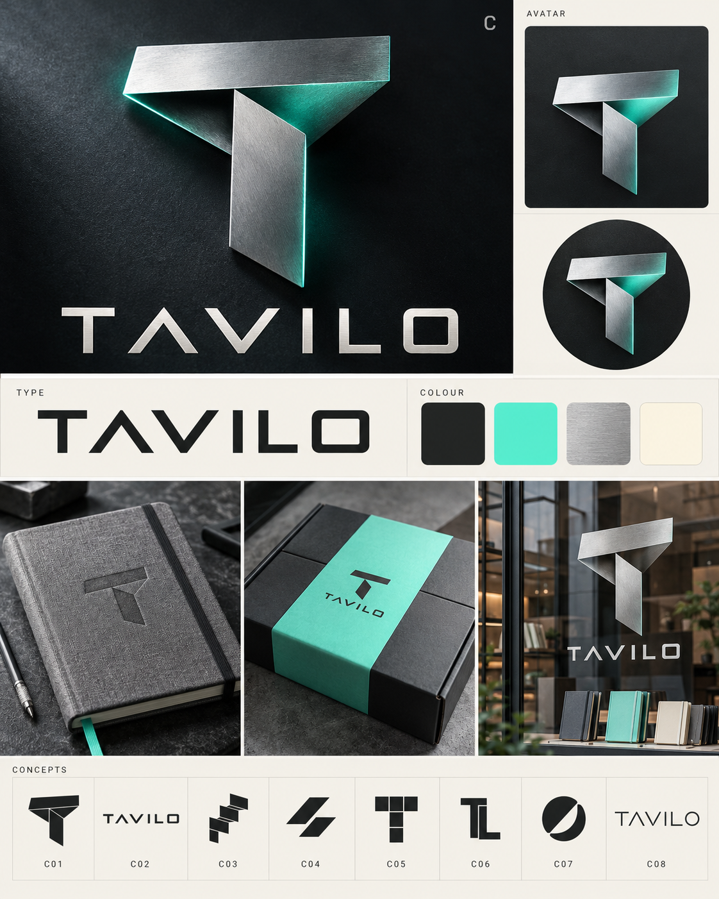

# creatorix · Brand Studio

**Аватарка, логотип и брендирование — в одной цельной презентации.**

Навык создаёт три разных брендборда. На каждом: крупный логотип, квадратная и круглая ава, цвета, типографика, 3–4 реалистичных носителя и восемь альтернативных знаков. Выбирайте направление целиком или сочетайте понравившиеся элементы.

Автор адаптации и сборки — **creatorix**. Версия **1.0.0**.

## Самый простой запуск

1. Скачайте [BRAND-STUDIO.md](https://raw.githubusercontent.com/egorfuks24-cloud/creatorix-brand-studio/main/BRAND-STUDIO.md).
2. Прикрепите файл к чату нейросети с генерацией изображений. Можно вставить текст целиком.
3. Отправьте запрос ниже, заменив данные бизнеса.

```text
Используй прикреплённый Brand Studio.
Название: [название или «придумай»]
Бизнес: [что делаем]
Аудитория: [для кого]
Характер: [3–5 слов]
Носители: [где будет бренд]
Не использовать: [клише и запреты]
Референсы/существующий логотип: [прикрепить при наличии]

Покажи три разных цельных брендборда отдельными изображениями.
На каждом — ава, логотип, палитра, типографика, реалистичные
носители и восемь альтернативных знаков. После показа дождись выбора.
```

Достаточно описать бизнес своими словами — навык уточнит существенные пробелы. Число досок и вариантов можно изменить.

## Установка как навыка

Скачайте **creatorix-brand-studio-skill.zip** в [релизе v1.0.0](https://github.com/egorfuks24-cloud/creatorix-brand-studio/releases/tag/v1.0.0).

- **Codex:** распакуйте папку `creatorix-brand-studio` в `~/.codex/skills/` и начните новый чат. Вызов: `$creatorix-brand-studio`.
- **Агент с поддержкой SKILL.md:** используйте его предусмотренный способ подключения папки или ZIP навыка.
- **Обычный чат:** достаточно `BRAND-STUDIO.md`, установка не нужна.

Генератор изображений в архив не входит. Если в среде нет визуальных инструментов, навык отдаёт промпт и явно сообщает, что изображения не созданы. Совместимость с каждым приложением отдельно не проверялась.

## Пример: TAVILO

Вымышленный бренд модульных блокнотов. Три направления одного задания, каждое с восемью вариантами внутри.

### A · Модульная графика


### B · Бумажная пластика


### C · Металл и геометрия


Чтобы выбрать, напишите, например: «B01» или «ава A04, материалы B». Для нового поиска: «Нужна новая серия, меньше геометрии и больше рукотворного характера».

## Что проверено

Визуальный прогон выполнен в Codex со встроенным генератором изображений. Все три доски просмотрены; несовпадения круглых аватарок A/B исправлены. Проверены структура YAML, соответствие самостоятельного файла навыку и целостность ZIP.

Это концептуальные растровые доски. Генератор может менять геометрию на мокапах. Производственные SVG, самостоятельные аватары в малых размерах, шрифтовые лицензии для конкретного бренда и регистрация названия требуют отдельной проверки после выбора. [Подробности проверки](VERIFICATION.md).

## Источники и лицензия

Адаптация объединяет подходы [Brandkit · Leonxlnx](https://github.com/Leonxlnx/taste-skill/tree/main/skills/brandkit) и [Logo Design · kaankiziltug](https://github.com/kaankiziltug/logo-design-skill), найденные через [исходную подборку](https://smart-purpose-e26.notion.site/Free-Logo-and-Brand-Kit-with-Claude-3f4716e8c1a58167b963d0de81996091).

В сборке переработаны процесс, форма подачи и выбор: цельные направления, аватарка вместе с брендированием, альтернативы внутри доски, переносимость в один файл. Библиотеки чужих логотипов и upstream-скрипты не включены. MIT-уведомления исходных авторов сохранены в [LICENSE](LICENSE) и самом навыке.
